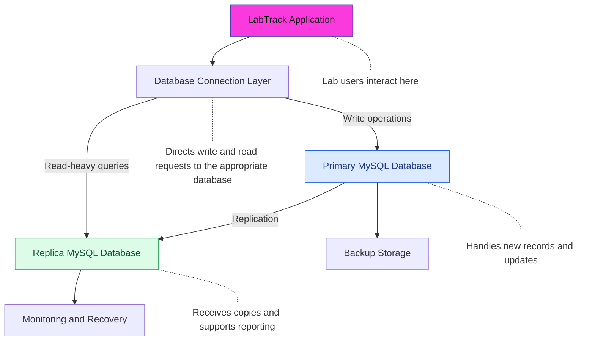

# LabTrack Distributed Database Architecture

## 1. Introduction

LabTrack is a simulated Laboratory Information Management System (LIMS) designed to manage laboratory operations, including patient registration, laboratory orders, specimen tracking, test processing and result management.

The initial implementation uses MySQL 8.0 as its relational database management system. The database stores related information across tables such as `patients`, `staff`, `lab_orders`, `specimens`, `order_tests` and `test_results`.

As LabTrack expands to support multiple laboratory branches and a growing number of users and diagnostic records, relying on a single database server may introduce scalability and availability challenges.

This document proposes a distributed database architecture for LabTrack using a MySQL primary–replica model. The proposed architecture aims to improve read scalability, support database recovery and provide a foundation for future expansion.

The architecture also discusses sharding, availability, consistency and possible cloud deployment.

## 2. Proposed Distributed Database Architecture

The proposed architecture uses a primary–replica database configuration.

The primary database is responsible for processing write operations, while one or more replica databases receive copies of changes from the primary.

The LabTrack application communicates with the database infrastructure. Write operations are directed to the primary database, while suitable read-heavy operations, such as report generation and analytical queries may be directed to a replica.

### 2.1 Architecture Components

| Component | Responsibility |
|---|---|
| LabTrack application | Provides access to laboratory functions for front desk personnels, laboratory scientists, pathologists and requesting clinicians. |
| Primary MySQL database | Stores and processes new records, updates and other write operations. |
| Replica MySQL database | Receives replicated changes from the primary and can support read operations. |
| Database monitoring | Monitors database health, replication status and availability. |
| Backup storage | Stores database backups to support recovery following data loss or infrastructure failure. |

### 2.2 Proposed Architecture Diagram

The following diagram illustrates the proposed database arrangement.

The diagram represents a proposed architecture rather than an implemented multi-server environment.

## 3. Database Distribution Strategy

### 3.1 Primary–Replica Replication

The primary–replica model will be used to distribute database workloads.

The primary database handles changes to laboratory records, including patient registration, addition of laboratory orders, specimen updates and test-result processing and entry.

The replica receives changes from the primary through MySQL replication. It can support read-intensive operations, such as generating reports and retrieving historical laboratory statistics.

This arrangement can reduce the number of read requests handled by the primary database and provide an additional database instance that may be considered for recovery if the primary becomes unavailable.

Replication does not automatically guarantee that both databases contain identical data at every moment. Replication delay may occur, particularly when there are network interruptions or high workloads.

### 3.2 Proposed Sharding Strategy

As LabTrack expands to support multiple laboratory branches, horizontal sharding could be considered.

Sharding involves dividing a database into smaller portions and distributing those portions across multiple database servers.

For LabTrack, a possible approach is branch-based sharding, where laboratory records are allocated according to the branch responsible for the patient's registration or laboratory order.

For example:

| Database shard | Possible data allocation |
|---|---|
| Lagos shard | Records assigned to the Lagos laboratory branch |
| Port Harcourt shard | Records assigned to the Port Harcourt laboratory branch |
| Abuja shard | Records assigned to the Abuja laboratory branch |

A branch identifier would be required to determine where records are stored and retrieved.

However, this approach introduces additional complexity. LabTrack would need a mechanism to locate patient records across branches, manage patients who visit more than one branch and maintain relationships between related records.

For this reason, branch-based sharding is proposed as a future scalability strategy rather than part of the initial implementation.

## 4. Availability and Fault Tolerance

Availability refers to the ability of a database system to remain accessible when users need it.

In the proposed LabTrack architecture, the replica database provides an additional database instance that may support recovery if the primary database experiences a failure.

A controlled failover process would involve:

1. Detecting that the primary database is unavailable.
2. Checking the health and replication status of the replica.
3. Assessing whether the replica contains the required committed transactions.
4. Promoting an appropriate replica to become the new primary.
5. Redirecting application connections to the promoted database.
6. Monitoring the system after recovery.

Automatic failover would require additional configuration and testing. The presence of a replica alone does not mean that failover happens automatically.

Database backups would also be maintained separately from replication. This is important because accidental deletion or incorrect updates may otherwise be copied to the replica.

## 5. Data Consistency

Consistency is important in LabTrack because the system manages patient information, laboratory orders and diagnostic results.

In a distributed database environment, data may not become available on every replica immediately after a transaction is committed on the primary.

This can result in replication lag, where a replica temporarily contains an older version of the data.

LabTrack would use different consistency requirements depending on the importance of the operation.

| Data or operation | Proposed consistency requirement | Reason |
|---|---|---|
| Patient identity updates | Strong consistency for critical updates | Helps prevent conflicting patient information. |
| Laboratory result entry and authorisation | Strong consistency for critical workflow operations | Helps protect the integrity of diagnostic results and their approval status. |
| Laboratory order status updates | Strong consistency for critical status transitions | Prevents users from acting on outdated order states. |
| Reporting and analytical dashboards | Eventual consistency may be acceptable | A short delay in reporting data may be tolerable. |

Critical operations should be directed to the primary database rather than relying on potentially delayed replica data.

The application should also enforce appropriate transaction controls, access permissions and result-authorisation rules.

## 6. Proposed Cloud Deployment

Although the initial LabTrack implementation uses a local MySQL environment, the proposed architecture could be deployed using cloud infrastructure as the system expands.

A cloud-based database service could host the primary database and its replicas without requiring the organisation to maintain all the underlying physical server infrastructure.

For example, a managed MySQL service such as Amazon Relational Database Service (Amazon RDS for MySQL) could be considered.

Potential benefits include:

- Managed database infrastructure.
- Automated backup options.
- Database monitoring.
- Support for replication and high-availability configurations, depending on the selected service and configuration.
- Infrastructure scalability as the number of users and records increases.

Cloud deployment would also require appropriate network security, encryption, access control, backup policies and disaster-recovery planning.

Because LabTrack handles sensitive laboratory information, the organisation would need to assess applicable data-protection requirements before selecting a cloud provider and deployment region.

Cloud deployment is a proposed future option and has not been implemented as part of the current LabTrack project.

## 7. Security Considerations

The distributed architecture would require security controls across all database instances.

Important considerations include:

- **Authentication:** Only authorised application services and users should access the database.
- **Role-based access control:** Registration officers, laboratory scientists, pathologists and requesting clinicians should have permissions appropriate to their responsibilities.
- **Encryption:** Data should be protected during transmission between database servers and when stored.
- **Replication security:** Replication connections and credentials should be protected.
- **Audit logging:** Important database activities should be recorded to support accountability and investigation.
- **Backup protection:** Backups should be secured and periodically tested to confirm that they can be restored.

## 8. Limitations and Challenges

Although the proposed architecture offers scalability and availability benefits, it also introduces challenges.

| Challenge | Possible impact | Proposed mitigation |
|---|---|---|
| Replication lag | Replicas may temporarily contain outdated information. | Monitor replication and direct critical reads to the primary. |
| Network failure | Database servers may be unable to communicate. | Use reliable network connections and appropriate recovery procedures. |
| Failover complexity | Promoting a replica incorrectly may cause data loss or conflicting database histories. | Implement controlled failover procedures and verify transaction status. |
| Sharding complexity | Records may be distributed across multiple servers. | Introduce a reliable shard-routing mechanism and branch identifiers. |
| Security management | More database instances increase the number of systems requiring protection. | Apply consistent security policies, access controls and monitoring. |
| Operational cost | Additional servers and cloud services increase infrastructure costs. | Select infrastructure according to workload and organisational needs. |

## 9. Conclusion

The proposed distributed database architecture provides a possible approach to supporting the future growth of LabTrack.

Using MySQL primary–replica replication would allow database changes to be copied to additional database instances, support read scalability and provide an additional option for recovery.

Branch-based sharding could be introduced in the future if the volume of laboratory records and geographical distribution of users make it necessary.

The architecture also highlights the importance of availability, consistency, security, backups and disaster recovery when managing laboratory information.

The proposed design builds on the existing MySQL implementation while providing a foundation for future distributed or cloud-based deployment.
