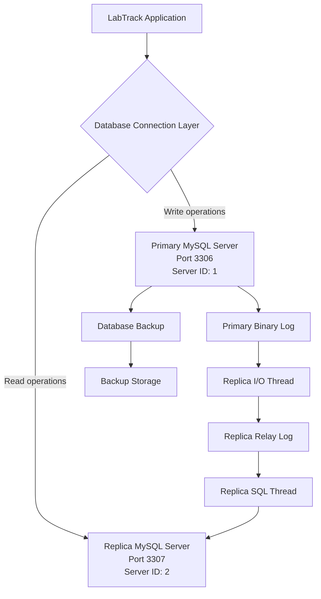

# LabTrack Primary–Replica Database Replication

## 1. Introduction

This implementation demonstrates a distributed database architecture using MySQL primary–replica replication for the LabTrack Laboratory Information Management System (LIMS).

LabTrack manages laboratory operations, including patient registration, test requests, specimen tracking, laboratory results and reporting. As the volume of laboratory transactions increases, relying on a single database server can introduce performance bottlenecks and create a single point of failure.

To address these concerns, a primary–replica architecture was implemented using two independent MySQL Server instances on a local Windows machine.

The primary server handles database write operations, while the replica maintains a synchronised copy of the primary database. The replica can support read-intensive operations such as reporting and historical record retrieval.

The implementation uses asynchronous, file-position-based replication.

## 2. Replication Architecture

The architecture consists of the following components:

- **Primary database:** Handles write operations and maintains the authoritative LabTrack database.
- **Binary log:** Records database changes on the primary server.
- **Replica I/O thread:** Connects to the primary and retrieves binary log events.
- **Relay log:** Temporarily stores events received from the primary.
- **Replica SQL thread:** Applies the received events to the replica database.
- **Replica database:** Maintains a copy of the primary database.

### Replication Architecture diagram



**Figure 1: LabTrack primary–replica database architecture.**

The primary server processes database modifications and records them in its binary log. The replica retrieves these events through its I/O thread, stores them in its relay log and applies them through its SQL thread.

This separation allows the replica to maintain a copy of the primary database without requiring application users to manually export and import updated records.

## 3. Implementation Environment

The implementation was carried out on a Windows machine using MySQL Server 8.0.46 and MySQL Workbench.

Two independent MySQL server instances were configured using separate data directories and configuration files.

| Configuration | Primary | Replica |
|---|---|---|
| Database system | MySQL 8.0.46 | MySQL 8.0.46 |
| Host | 127.0.0.1 | 127.0.0.1 |
| Port | 3306 | 3307 |
| Server ID | 1 | 2 |
| Database | labtrack_db | labtrack_db |
| Binary logging | Enabled | Enabled |
| Read-only mode | Disabled | Enabled |
| Super read-only mode | Disabled | Enabled |
| Windows service | MySQL80 | MySQL80Replica |

The two instances run on the same physical computer but use separate MySQL data directories.

**Primary data directory:** Existing MySQL Server 8.0 data directory.

**Replica data directory:**

`C:\ProgramData\MySQL\MySQL Server 8.0\ReplicaData`

**Replica configuration file:**

`C:\ProgramData\MySQL\MySQL Server 8.0\my-replica.ini`

The replica was assigned a unique server ID to distinguish it from the primary during replication.

## 4. Primary Server Configuration

The existing MySQL instance was configured as the primary server.

The primary configuration included:

```ini
[mysqld]
server-id=1
log-bin="DESKTOP-FPQTJ48-bin"
```

Binary logging was enabled to record database changes that could subsequently be transmitted to the replica.

The primary server was configured to permit normal database operations, including INSERT, UPDATE and DELETE statements.

### Replication user

A dedicated replication account was created on the primary server:

```sql
CREATE USER 'labtrack_repl'@'%'
IDENTIFIED BY 'YOUR_STRONG_PASSWORD';

GRANT REPLICATION SLAVE
ON *.*
TO 'labtrack_repl'@'%';
```

The account was granted replication privileges to allow the replica to retrieve binary log events.

## 5. Replica Server Configuration

A second MySQL instance was created using the existing MySQL Server installation files.

Its configuration was stored separately in `my-replica.ini`.

The relevant configuration was:

```ini
[mysqld]
server-id=2
port=3307
mysqlx_port=33070

basedir="C:/Program Files/MySQL/MySQL Server 8.0/"

datadir="C:/ProgramData/MySQL/MySQL Server 8.0/ReplicaData/"

log-bin="LabTrackReplica-bin"
relay-log="LabTrackReplica-relay-bin"

read_only=ON
super_read_only=ON
```

The replica was registered as a separate Windows service named `MySQL80Replica`.

The two services were started and verified using PowerShell.

The replica's configuration was also verified through MySQL Workbench:

```sql
SELECT
    @@hostname AS hostname,
    @@port AS port,
    @@server_id AS server_id,
    @@read_only AS read_only,
    @@super_read_only AS super_read_only,
    @@datadir AS data_directory;
```

The replica returned port `3307`, server ID `2`, and enabled read-only settings.

The read-only configuration prevents ordinary application users from modifying the replica directly. Replication events can still be applied by the replication process.

## 6. Initial Database Synchronisation

Before replication could begin, the replica needed an initial copy of the primary database.

A logical backup of `labtrack_db` was created using MySQL's `mysqldump` utility.

The following command was executed in PowerShell:

```powershell
.\mysqldump.exe `
  -h 127.0.0.1 `
  -P 3306 `
  -u root `
  -p `
  --single-transaction `
  --source-data=2 `
  --set-gtid-purged=OFF `
  --routines `
  --triggers `
  --events `
  --databases labtrack_db `
  --result-file="C:\LabTrackReplication\labtrack_backup.sql"
```

The `--single-transaction` option provided a consistent snapshot for the InnoDB tables without requiring a long table lock.

The `--source-data=2` option included the primary's binary log coordinates as a commented SQL statement in the backup file.

The backup was saved at:

`C:\LabTrackReplication\labtrack_backup.sql`


### Binary log coordinates

The backup contained the following replication coordinates:

| Parameter | Value |
|---|---|
| Binary log file | DESKTOP-FPQTJ48-bin.000003 |
| Binary log position | 3535880 |

These coordinates identified the point from which the replica should begin retrieving subsequent changes.

The backup was imported into the replica using the MySQL command-line client:

```powershell
cmd.exe /c '"C:\Program Files\MySQL\MySQL Server 8.0\bin\mysql.exe" -h 127.0.0.1 -P 3307 -u root -p < "C:\LabTrackReplication\labtrack_backup.sql"'
```

After importing the backup, the replica contained the eight existing LabTrack tables:

- patients
- staff
- lab_tests
- lab_orders
- order_tests
- specimens
- test_results
- summary_daily_test_counts

The replica was subsequently returned to read-only mode.

## 7. Configuring Replication

Replication was configured on the replica using the binary log coordinates obtained from the initial backup.

The following command established the primary connection:

```sql
CHANGE REPLICATION SOURCE TO
    SOURCE_HOST = '127.0.0.1',
    SOURCE_PORT = 3306,
    SOURCE_USER = 'labtrack_repl',
    SOURCE_PASSWORD = 'YOUR_STRONG_PASSWORD',
    SOURCE_LOG_FILE = 'DESKTOP-FPQTJ48-bin.000003',
    SOURCE_LOG_POS = 3535880,
    GET_SOURCE_PUBLIC_KEY = 1;
```

The `GET_SOURCE_PUBLIC_KEY` option was enabled to support authentication using the `caching_sha2_password` authentication plugin in this local environment.

Replication was started using:

```sql
START REPLICA;
```

The replication process was monitored using:

```sql
SHOW REPLICA STATUS;
```

Two replication threads were involved:

1. **Replica I/O thread:** Retrieves binary log events from the primary.
2. **Replica SQL thread:** Applies the retrieved events to the replica database.

Successful operation requires both threads to be running.

## 8. Replication Testing and Verification

A practical test was performed to verify that changes made on the primary were automatically reflected on the replica.

A separate test database was created on the primary server:

```sql
CREATE DATABASE labtrack_replication_test;

USE labtrack_replication_test;

CREATE TABLE replication_demo (
    id INT PRIMARY KEY,
    message VARCHAR(255),
    created_at TIMESTAMP DEFAULT CURRENT_TIMESTAMP
);
```

A test record was inserted:

```sql
INSERT INTO replication_demo (id, message)
VALUES (
    1,
    'LabTrack primary-to-replica replication test'
);
```

The replica was then queried using:

```sql
SHOW DATABASES LIKE 'labtrack_replication_test';
```

The database appeared on the replica without manual creation or import.

The test record was retrieved using:

```sql
SELECT *
FROM labtrack_replication_test.replication_demo;
```

The replica returned the following record:

| id | message | created_at |
|---|---|---|
| 1 | LabTrack primary-to-replica replication test | 2026-10-30 12:12:53 |

The matching record confirmed that the database creation, table creation and INSERT operation had been replicated successfully.

### Final replication status

The replica's status was checked using:

```sql
SHOW REPLICA STATUS;
```

The following indicators were confirmed:

| Status field | Observed result |
|---|---|
| Replica_IO_Running | Yes |
| Replica_SQL_Running | Yes |
| Source_Host | 127.0.0.1 |
| Source_Port | 3306 |
| Source_Server_Id | 1 |
| Last_IO_Error | Empty |
| Last_SQL_Error | Empty |

Both replication threads were running, and the test record was available on the replica.

**Implementation result:** Successful primary–replica replication was configured and verified.

## 9. Monitoring, Recovery and Failover Considerations

Although replication was successfully demonstrated, a distributed database environment requires continuous monitoring and an appropriate recovery strategy.

### Replication monitoring

The following commands can be used to monitor replication:

```sql
SHOW REPLICA STATUS;
```

Important monitoring indicators include:

- `Replica_IO_Running`: Confirms whether the replica can retrieve events from the primary.
- `Replica_SQL_Running`: Confirms whether the replica can apply retrieved events.
- `Seconds_Behind_Source`: Provides an estimate of replication delay.
- `Last_IO_Error`: Reports connection and event retrieval errors.
- `Last_SQL_Error`: Reports errors encountered while applying transactions.

Replication lag can occur when the primary generates changes faster than the replica can apply them, or when network connectivity is interrupted.

A replica that is behind the primary may return outdated information. Therefore, applications should consider replication lag before using the replica for time-sensitive clinical reporting.

### Recovery considerations

If the primary becomes unavailable, the replica can potentially be promoted to serve as the new primary.

However, this implementation does not include automatic failover.

A controlled manual promotion would require:

1. Confirming that the replica has applied all available transactions.
2. Assessing whether any transactions were lost during the interruption.
3. Stopping replication after the old primary has been safely isolated.
4. Disabling the replica's read-only restrictions.
5. Reconfiguring the application to use the promoted server.
6. Re-establishing replication when the original primary is recovered.

Automatic failover would require additional infrastructure, monitoring and orchestration beyond the scope of this local implementation.

### Backup considerations

Replication is not a replacement for database backups.

Accidental deletion, incorrect updates or data corruption can be replicated from the primary to the replica.

Regular independent backups are therefore necessary to support database recovery.

## 10. Limitations of the Implementation

The implementation successfully demonstrated MySQL primary–replica replication, but it has several limitations:

1. **Single physical machine:** Both MySQL instances run on the same computer. Consequently, hardware failure could affect both servers.
2. **Asynchronous replication:** Changes are not guaranteed to reach the replica immediately. Temporary replication lag is possible.
3. **No automatic failover:** Promotion of the replica requires manual intervention.
4. **Local network environment:** The implementation uses localhost rather than separate physical or cloud-hosted servers.
5. **Security:** Public-key retrieval was enabled for local authentication without configuring TLS. A production deployment should use encrypted connections and appropriately secured credentials.
6. **Read scaling not fully implemented:** Although the replica is configured to support read-only access, application-level read/write routing was not implemented or benchmarked.

These limitations distinguish the local demonstration from a production-ready distributed database deployment.

## 11. Conclusion

The LabTrack primary–replica implementation demonstrates how database distribution can improve the availability of database copies and provide opportunities for read workload distribution.

Two independent MySQL Server instances were configured with unique server IDs and ports. The existing LabTrack database was synchronised using a logical backup, and file-position-based asynchronous replication was established.

The implementation also involved practical troubleshooting of authentication and replication transaction errors.

Successful replication was confirmed by observing both replication threads running and verifying that a newly created database, table and record on the primary appeared automatically on the replica.

Although the implementation was performed locally, it provides a practical foundation for understanding distributed database architecture, replication monitoring, recovery planning and the considerations involved in deploying a more scalable database environment.
